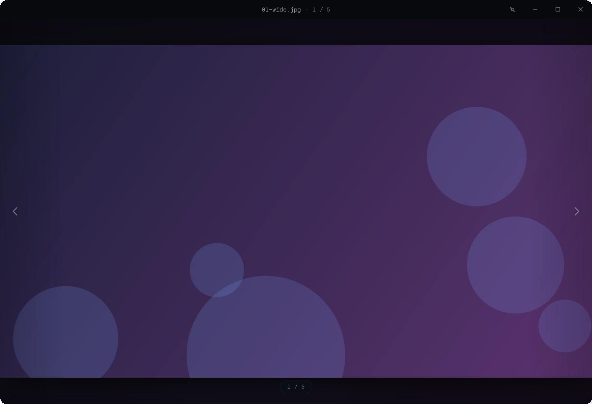

<p align="right"><sub><b>English</b> · <a href="README.md">Español</a></sub></p>

<div align="center">

# Lumen

**A dark, frameless, ultra-minimal image viewer for Windows.**

The lightweight replacement for the photo viewer: it opens instantly, with no distractions. A single portable `.exe`.


[](https://github.com/agustinyarrus/lumen/releases/latest)
[](https://github.com/agustinyarrus/lumen/releases)



</div>

---

## ✨ What it is

**Lumen** is an image viewer that gets out of the way: pure content, chrome that hides itself, smooth zoom to the
cursor and crossfade navigation. A single **WebView2 window without the system frame** (the page draws the title
bar); the bytes of each image are served from a local HTTP server. **It works 100% offline.**

## 🖼️ Formats

Native to the browser, served raw (fast, with _range requests_):

> `jpg` · `jpeg` · `png` · `apng` · `gif` · `webp` · `avif` · `bmp` · `ico` · `svg`

And the ones the browser doesn't understand are **decoded in Go on the fly**:

> `tif` · `tiff`

## 🎛️ Features

- **Fit the window to the image** or **keep its size**: a toggle in the title bar, remembered between sessions.
- **Zoom to the cursor** with the wheel, pan by dragging, double-click to switch between fit and detail.
- **Folder navigation** in natural order (`photo2` before `photo10`) with neighbor preloading.
- **Single instance**: the 1st window stays alive; every later `lumen.exe ` opens in **~0.3 s**.
- **Drag and drop**, fullscreen, and Windows 11's native rounded corners and dark border.
- Startup without _flash_ or _ghosting_: the window is born frameless and dark from the very first pixel.

## ⌨️ Shortcuts

| Key                   | Action                       |
|-----------------------|------------------------------|
| `←` / `→` / `Space`   | Previous / next image        |
| `wheel`               | Zoom to the cursor           |
| `double-click`        | Fit ↔ detail                 |
| `+` / `-` / `0`       | Zoom in / out / fit          |
| `F` / `F11` / `Esc`   | Fullscreen                   |
| `Ctrl O`              | Open                         |

## 📦 Installation

> Requires [**Go**](https://go.dev) 1.24+ to build and the **WebView2 runtime** (it ships with Windows 11).

```powershell
git clone https://github.com/agustinyarrus/lumen.git
cd lumen
.\build.ps1      # builds lumen.exe (release, no console, with icon)
.\install.ps1    # installs to Program Files + Start Menu and adds it to "Open with" (admin)
```

`.\install.ps1 -Uninstall` reverts it. Or simply:

```powershell
lumen.exe foto.jpg
```

## 🏗️ Architecture

| File            | Role                                                                     |
|-----------------|--------------------------------------------------------------------------|
| `main.go`       | Frameless host + local HTTP server + single instance + fit to image      |
| `config.go`     | Persistent preferences (`%AppData%\Lumen\config.json`)                   |
| `winapi.go`     | Native open dialog, fullscreen, monitor work area                        |
| `webview_bg.go` | Dark background for WebView2's `about:blank` (anti-flash)                |
| `ui/`           | Embedded HTML + CSS + JS (`//go:embed`)                                  |

## 📄 License

MIT © Agustín Yarrus — see [LICENSE](LICENSE).

<!-- i18n source=README.md sha256=22885dc28e88 -->
